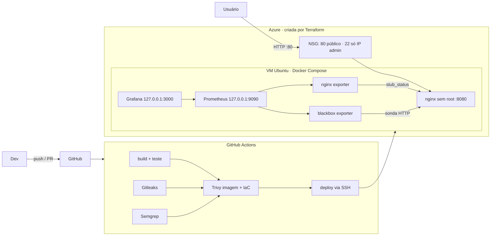

# Rua Acesa — MVP publicado por pipeline DevSecOps

Global Solution 2026.2 · CitizenTech · Engenharia de Software 4º ano · FIAP · disciplina *Secure DevOps Tools & Cloud Computing*.

| Item | Link |
| --- | --- |
| URL pública do MVP | _preencher com o output `url_site` do Terraform_ |
| Repositório | _preencher_ |
| Pipeline (Actions) | _preencher_ |

## Ficha Técnica do MVP

| Campo | Descrição |
| --- | --- |
| **Produto** | Rua Acesa |
| **Cidadão e território** | Quem circula a pé à noite em São Paulo: trabalhadores que voltam tarde, estudantes, mulheres e quem espera em ponto de ônibus. |
| **Problema** | Ruas com poste apagado deixam o trajeto noturno inseguro, e o cidadão não sabe como reclamar nem acompanha se o reparo acontece. |
| **Proposta de valor** | O cidadão (ou o robô de inspeção) registra o ponto escuro com foto, a IA confirma e prioriza, e o sistema encaminha a solicitação e mostra no mapa onde a cidade está escura. |
| **Componentes** | Visão computacional (YOLO), robô de automação RPA em Python, painel de revisão humana, mapa e dados abertos (GeoSampa). |
| **ODS** | 11 (cidades seguras), 10 (expõe a periferia com mais pontos escuros) e 9 (infraestrutura monitorada com IA e dados abertos). |
| **Este MVP** | Página pública que apresenta a equipe e a ideia, publicada por container, Terraform e pipeline com varredura de segurança. |

**Equipe:** Gabriel Diegues Figueiredo Rocha (RM 550788) · Pedro Henrique Palladino (RM 551180) · Henrique Pontes (RM 98036) · Raí Gumieri dos Santos (RM 98287).

## Arquitetura



| Camada | Tecnologia | Arquivo |
| --- | --- | --- |
| Site | HTML/CSS estático em nginx sem privilégio | `index.html`, `style.css`, `conf.d/default.conf` |
| Container | Dockerfile enxuto, uid 101, sem segredo; compose com FS somente leitura, `cap_drop: ALL` | `Dockerfile`, `docker-compose.yml` |
| IaC | Terraform azurerm: RG, VNet, NSG, IP público, VM | `infra/` |
| Pipeline | GitHub Actions: build, Gitleaks, Semgrep, Trivy, deploy | `.github/workflows/devsecops.yml` |
| Observabilidade | Prometheus, Grafana, nginx exporter, blackbox exporter | `observabilidade/` |

## Segurança

| Controle | Como |
| --- | --- |
| Sem segredo na imagem | `.dockerignore` exclui `.env`; o compose recusa subir sem `GRAFANA_ADMIN_PASSWORD`. |
| Segredos no CI | Só em GitHub Secrets (`VM_HOST`, `VM_SSH_KEY`, `GRAFANA_ADMIN_PASSWORD`). Gitleaks barra vazamento. |
| Imagem | Usuário não root, `apk upgrade`, Trivy (HIGH/CRITICAL) bloqueando o deploy. |
| Código e IaC | Semgrep (Dockerfile, Terraform, GitHub Actions) e Trivy config. |
| Nuvem | State e `.tfvars` fora do repo (`.gitignore`). `admin_cidr` rejeita `0.0.0.0/0`: a porta admin nunca fica aberta ao mundo. |
| Exceção registrada | A porta 80 é pública de propósito (URL pública do MVP), justificada em `.trivyignore`. Prometheus e Grafana só em `127.0.0.1`; a porta de métricas do nginx (8081) não é publicada. |
| Cabeçalhos HTTP | CSP restritiva, `nosniff`, `X-Frame-Options: DENY`, `server_tokens off`. |

## Observabilidade: as 4 métricas de ouro

Dashboard **"Rua Acesa — 4 métricas de ouro"** no Grafana.

| Métrica | Fonte | Métrica Prometheus |
| --- | --- | --- |
| Latência | blackbox (sonda HTTP) | `probe_duration_seconds`, `probe_http_duration_seconds` |
| Tráfego | nginx exporter | `rate(nginx_http_requests_total[1m])` |
| Erros | blackbox | `probe_success`, `probe_http_status_code` |
| Saturação | nginx exporter | `nginx_connections_active`, `nginx_connections_waiting` |

Alertas (`observabilidade/alertas.yml`): `SiteForaDoAr`, `NginxSemMetricas`, `LatenciaAlta`, `ConexoesAltas`.
Para disparar um: `docker stop rua-acesa-web`. Em 1 a 2 minutos `SiteForaDoAr` fica *firing* em Prometheus (`/alerts`) e no painel "Alertas disparando" do Grafana. Depois, `docker start rua-acesa-web`.

Prometheus e Grafana também podem rodar localmente apontando para o MVP publicado: troque o alvo do job `site` em `observabilidade/prometheus.yml` pela URL pública (e remova o job `nginx`, que só existe dentro da VM).

## Responsabilidade compartilhada

| Item | Microsoft Azure | Equipe |
| --- | --- | --- |
| Datacenter, hardware, hypervisor, rede física | ✔ | |
| Disponibilidade da plataforma (IaaS) | ✔ | |
| Sistema operacional da VM (patches, hardening) | | ✔ |
| Regras de firewall (NSG) | | ✔ (Terraform) |
| Docker, imagens e dependências | | ✔ (Trivy no pipeline) |
| Código, segredos e chaves SSH | | ✔ (GitHub Secrets, Gitleaks) |
| Dados pessoais e LGPD | | ✔ |
| Monitoramento e resposta a alertas | | ✔ |

## Dados pessoais (LGPD)

Esta página **não coleta nem armazena dado pessoal**: é HTML estático, sem formulário, cookie ou rastreador, e os logs do nginx não são exportados. Os únicos nomes e RMs exibidos são os da própria equipe.

No produto completo (RPA e painel), o único dado pessoal é o contato opcional do cidadão, guardado como hash HMAC-SHA256 com salt na base da aplicação. A foto é regravada sem EXIF/GPS e apagada 30 dias após o caso encerrado. Nenhum dado pessoal vai para o GitHub, a imagem ou o Prometheus.

## Estimativa de custo (Azure, Brazil South, 24×7)

Valores **aproximados**; confirme na [calculadora da Azure](https://azure.microsoft.com/pricing/calculator/).

| Recurso | Configuração | US$/mês |
| --- | --- | --- |
| VM Linux | Standard_B1ms (1 vCPU, 2 GiB) | 20–25 |
| Disco do SO | 30 GB Standard SSD | 3–4 |
| IP público | Standard, estático | 3–4 |
| Rede de saída | tráfego baixo | ~0 |
| GitHub Actions, Prometheus, Grafana | repo público / rodam na VM | 0 |
| **Total** | | **≈ 26–33** |

Em uma ou duas semanas de avaliação, cerca de US$ 6–15. `terraform destroy` zera a cobrança.

## Como reproduzir

**Local:**

```bash
cp .env.example .env            # defina GRAFANA_ADMIN_PASSWORD
docker compose up -d --build
# site http://localhost · Prometheus http://localhost:9090 · Grafana http://localhost:3000 (admin)
```

**Nuvem:**

```bash
cd infra
cp terraform.tfvars.example terraform.tfvars   # subscription_id, admin_cidr (seu IP /32), chave SSH, repo_url
terraform init -backend-config="resource_group_name=..." -backend-config="storage_account_name=..." \
               -backend-config="container_name=tfstate" -backend-config="key=rua-acesa-web.tfstate"
terraform apply
```

O output `url_site` é a URL pública. A VM clona o repo em `~/app`; entre por SSH uma vez, crie o `.env` e rode `docker compose up -d --build`. Depois cadastre os secrets `VM_HOST`, `VM_SSH_KEY` e `GRAFANA_ADMIN_PASSWORD` e o environment `producao`: cada push na `main` testa, escaneia e faz o deploy.

**Pipeline barrado e corrigido:** commite um segredo falso (ex.: `aws_secret_access_key = wJalrXUtnFEMI/K7MDENG/bPxRfiCYEXAMPLEKEY`) numa branch. O job Gitleaks falha e nada é publicado. Remova o segredo e o pipeline fica verde.
# global-soluction-devops-2026-
